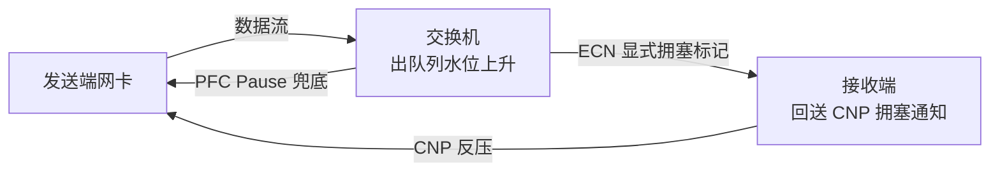

# 数据中心网络产品经理 知识点大纲（AI Fabric 方向）

> 本大纲由一份真实 JD 反推生成：先把 JD 的每句话拆成"能力项"，再把能力项翻译成"可被面试官验证的知识点"，最后给出备考路径与自测清单。
> 适用目标岗位：数据中心交换机 / 智算网络产品经理（厂商侧，非甲方运维岗）。
>
> **本文件是 v1.0 能力大纲（索引层）**。配套的精讲五册、题库两册与冲刺手册见 [[00-学习总索引]]。

## 目录

- [[#0. 使用说明|0. 使用说明]]
- [[#1. 岗位画像与面试考察逻辑|1. 岗位画像与面试考察逻辑]]
- [[#2. 技术基底（技术可信度的地基）|2. 技术基底]]
- [[#3. 产品思维（把需求变成可交付的版本）|3. 产品思维]]
- [[#4. 业务视野（懂场景、知生态、会协同）|4. 业务视野]]
- [[#5. 软技能（面试的隐性评分项）|5. 软技能]]
- [[#6. 备考路径与自测|6. 备考路径与自测]]
- [[#附录 A 术语表（英中对照）|附录 A 术语表]]
- [[#附录 B 信息源清单|附录 B 信息源清单]]
- [[#附录 C 既有经验的迁移点（APM 背景加分项）|附录 C 经验迁移点]]

---

## 0. 使用说明

### 0.1 体例与掌握等级

**难度标记**：★ 知道概念即可（能讲清是什么）｜★★ 能讲清原理与取舍（面试官会追问"为什么"）｜★★★ 能独立设计与辩护（要求给出方案、算得清账、答得上反驳）

**章节编号**：`§` 开头的是章节引用，全部做成了可点击锚点；本文所有交叉引用均为链接，点击即跳转。

**内容属性标注**：凡标 `[待核实]` 的数据或型号，属于口径可能随时间变化的公开信息，面试前需以官方资料复核，不可直接背诵。

**核心判断**：这份 JD 的技术门槛不低（明确写了 EVPN-VXLAN、智算网络、TCP/IP、BGP、OSPF），但它要的不是"网络工程师"，而是"能判断技术方案值不值、能不能卖"的人。因此技术部分的目标是**技术可信度**（不被研发和客户问倒），不是**技术深度**（不要求配得出一条命令）。

### 0.2 JD 能力项 → 知识域映射

| JD 原文要点 | 拆解出的能力 | 对应知识域 | 权重建议 |
|---|---|---|---|
| 懂架构、通协议、知趋势 | 架构演进判断力 + 协议原理 + 技术预判 | [[#2. 技术基底（技术可信度的地基）\|§2.1–§2.9]] | 40% |
| 洞察客户需求、形成产品概念、打造竞争力 | 需求洞察 + 竞品分析 + 概念定义 | [[#3.1 需求洞察：从客户抱怨到真实诉求\|§3.1]]、[[#3.2 竞品与市场分析\|§3.2]] | 15% |
| 转化为清晰的产品需求文档、制定 Roadmap、推动上线 | 需求工程 + 规划 + 跨部门交付 | [[#3.3 需求工程：从 MRD 到 PRD\|§3.3]]、[[#3.5 产品规划与 Roadmap\|§3.5]]、[[#3.6 研发协同与高质量交付\|§3.6]] | 15% |
| 客户信任度提升（交付、质量、技术领先诉求） | 质量问题闭环 + 客户沟通 | [[#3.7 上市与生命周期管理\|§3.7]]、[[#5.2 跨部门协同与冲突处理\|§5.2]] | 5% |
| 深入典型业务场景、清楚不同场景部署 | 场景-组网映射能力 | [[#4.1 客户分层与行业场景地图\|§4.1]]、[[#4.2 典型组网与部署形态\|§4.2]] | 10% |
| 了解产业链生态、生态协同规划 | 生态位判断 | [[#4.3 产业链与生态协同\|§4.3]] | 5% |
| 沟通表达、抗压决策、学习力、全局与细节 | 表达结构与决策质量 | [[#5. 软技能（面试的隐性评分项）\|§5]] | 10% |

### 0.3 学习优先级与时间分配

按"投入产出比"排序，不要平铺直叙地读书：

1. **第一优先（先补，1–2 天）**：[[#2.5 Overlay 协议族：VXLAN 与 EVPN|§2.5]] + [[#2.7 智算网络：RoCEv2、无损以太与 AI Fabric|§2.7]]。这两块是 JD 点名、且最容易在面试中被"追问到底"的部分。
2. **第二优先（3–5 天）**：[[#2.2 数据中心网络架构四代演进|§2.2]]、[[#2.4 路由协议：OSPF、IS-IS 与 BGP 的边界|§2.4]]、[[#4.2 典型组网与部署形态|§4.2]]。这三块构成"你懂客户现场"的底盘。
3. **第三优先（2–3 天）**：[[#3. 产品思维（把需求变成可交付的版本）|§3]] 全章。技术强、产品弱是最常见的落选原因。
4. **长期并行**：[[#2.9 技术趋势雷达（2026—2028）|§2.9]] 与 [[#4.3 产业链与生态协同|§4.3]]，用"每周一条行业信息"的节奏维持，不要集中突击。

---

## 1. 岗位画像与面试考察逻辑

### 1.1 这个岗位到底在卖什么

结论先行：**这个岗位的产出不是功能，是"判断"。** 具体是三类判断——

1. **技术判断**：哪个架构方向值得投入（例如是否为一个客户做深缓冲框式，还是把资源压到 rail-optimized 智算方案）。
2. **优先级判断**：在客户定制、标准产品、平台演进三条线之间分配研发资源。
3. **商业判断**：这个需求能换来多少订单、多少毛利、多少标杆价值。

因此面试中的绝大多少问题，本质都在问"你依据什么做决定"。回答时若只给结论不给依据，技术再强也会被判定为"工程师思维"。

### 1.2 面试官的三条验证主线

| 主线 | 面试官在验证 | 常见问法 | 不合格表现 |
|---|---|---|---|
| 技术可信度 | 你说的技术是不是真的懂，还是背的 | "PFC 为什么会死锁？" "EVPN 五种路由分别干什么？" | 只会背定义，答不出取舍与代价 |
| 产品方法论 | 你有没有结构化的需求处理流程 | "客户提了个需求，你从收到到上线怎么做？" | 只说"评估后推动研发"，没有分层与判据 |
| 客户与商业感 | 你懂不懂客户为什么掏钱 | "互联网客户和政企客户的需求差异在哪？" | 只说"互联网要大带宽"，说不出决策链差异 |

**建议准备方式**：为每条主线准备 2 个真实案例（不是虚构），每个案例用 90 秒讲完：背景一句 → 冲突一句 → 你的判断依据两句 → 结果与代价一句。

### 1.3 面试轮次与考察侧重

- **技术面（研发/架构师出身）**：只关心技术细节与边界。会连续追问三层，例如"VXLAN 为什么要 overlay → 那 underlay 用什么 → 为什么不用 OSPF 而用 eBGP"。见 [[#2.5 Overlay 协议族：VXLAN 与 EVPN|§2.5]]、[[#2.4 路由协议：OSPF、IS-IS 与 BGP 的边界|§2.4]]。
- **产品面（产品线负责人）**：关心方法论与取舍。会问"给你 X 资源，Roadmap 怎么排"。见 [[#3.5 产品规划与 Roadmap|§3.5]]。
- **交叉面 / HR 面**：关心稳定性、抗压、动机。JD 明确写了"业绩考核导向"，要准备好对"KPI 压力下如何取舍"的回答。见 [[#5.3 抗压、决策与业绩导向|§5.3]]。

---

## 2. 技术基底（技术可信度的地基）

### 2.1 转发原理底座：报文的一生

**掌握等级：★★**

本节是"追问的终点"。任何 DC 网络问题，最后都能落回"包在哪个环节被丢了/被排队了"。

**知识点清单**

- **二层转发**：MAC 地址学习与老化、未知单播泛洪、广播域边界；生成树（STP/RSTP/MSTP）的收敛速度与链路利用率问题——这是数据中心抛弃 STP 的根本原因。
- **三层转发**：最长前缀匹配（longest prefix match）、ARP 表与邻居表、TTL、等价多路径（ECMP）。
- **硬件流水线**：解析器（parser）→ 查表（TCAM/SRAM）→ 交换网（fabric）→ 出队调度 → 出口整形；理解"转发与控制分离"意味着什么。
- **时延构成**（要能算）：串行化时延 + 传播时延 + 排队时延 + 设备处理时延。典型换算：1 KB 报文在 100G 端口上的串行化时延约 82 ns，在 400G 端口上约 20 ns。这个量级感是判断"时延优化是否值得投入"的前提。
- **MTU 与分片**：Overlay 封装会额外占用字节（见 [[#2.5 Overlay 协议族：VXLAN 与 EVPN|§2.5]] 的 50 字节开销），因此 DC 普遍把 MTU 提到 9000（巨帧）。
- **丢包位置清单**（排障必备）：入口缓存溢出、交换网信元（cell）丢弃、出口队列尾丢、光模块误码与 FEC 纠错失败、CPU 上送限速丢弃。

**高频追问**

1. "客户说网络丢包，你怎么定位？" → 按"先分层再分设备"回答：物理层看光功率/误码 → 链路层看 CRC 与聚合 → 网络层看路由震荡与 ECMP 不均 → 队列层看缓存与 PFC → 应用层看重传。
2. "为什么数据中心不用 STP？" → 收敛慢（秒级）、半数链路被阻塞、无法利用多路径带宽。

### 2.2 数据中心网络架构四代演进

**掌握等级：★★★**

**主线判断**：架构迭代的驱动力始终是三个变量的此消彼长——**东西向流量占比、带宽密度需求、可运维性要求**。

**四代要点**

| 代际 | 典型架构 | 解决的问题 | 遗留的问题 |
|---|---|---|---|
| 第一代 | 核心-汇聚-接入 + STP | 基本连通与广播域隔离 | 东西向绕行、链路利用率 ≤ 50% |
| 第二代 | 大二层（VSU/堆叠、TRILL/FabricPath）+ VLAN | 虚拟机迁移不跨网段、二层域扩大 | VLAN 上限 4094、控制面耦合、升级影响面大 |
| 第三代 | Spine-Leaf（两级 CLOS）+ VXLAN/EVPN | 无阻塞、ECMP 多路径、多租户、规模可横向扩展 | ECMP 哈希不均、运维复杂度上升、成本高 |
| 第四代 | Rail-Optimized / 多平面 + RoCEv2 或 UEC | 支撑万卡级训练、可预测时延、微突发承载 | 无损参数调优难、故障定位难、功耗与光互连成本 |

**必须能讲清的两个概念**

- **无阻塞（non-blocking）**：Spine 的上行带宽与 Leaf 的下行带宽按 1:1 收敛设计；实际部署常按 1:3、1:4 收敛以控成本，这就是"收敛比"（oversubscription），也是产品经理做配置与报价时的核心参数。JD 讲"不同场景下网络产品部署"，本质就是收敛比与端口规格的组合选择。
- **两级 CLOS 的规模边界**：两层胖树可支撑的服务器规模由"Leaf 上行端口数 × Spine 数"决定；超过单级能力就必须引入第三级（Super-Spine）或改用多平面架构。会算这个账，才能回答"客户要 5000 张卡，你怎么组网"。

### 2.3 交换机硬件与芯片架构

**掌握等级：★★**

产品经理不必会画板，但必须理解"硬件约束如何决定产品定义"。

- **形态取舍**：盒式（box）vs 框式（chassis）。框式走多级多平面 CLOS、信元交换（cell-based）、零背板正交架构，优势是单机端口密度与长期演进性；盒式优势是成本、部署粒度、故障域小。要做"高密核心"还是"弹性叶层"，直接决定产品形态。
- **交换容量计算**：面板端口数 × 单端口速率 × 2（全双工）。这个数会出现在标书与对比表中，算错就是硬伤。
- **缓存策略**：浅缓冲（几十至数百 MB 共享）适合纯转发；深缓冲（GB 级）适合长肥管道（long fat pipe）与存储、DCI 场景。AI 训练的微突发（micro-burst）会同时考验缓存与调度。
- **核心芯片**：博通（Broadcom）Tomahawk 系列（51.2T / 102.4T 量级）、Jericho 系列（深缓冲 + 分布式调度，面向 AI 与广域）、思科 Silicon One、英伟达 Spectrum 系列；国产以盛科（Centec）为代表。**芯片可获得性本身就是产品竞争力的一部分**（供货周期、功能开放度、SDK 支持），这是国产厂商产品经理的高频议题。
- **光与 SerDes**：400G/800G 可插拔光模块（QSFP-DD/OSFP）、DR/FR 传输距离差异、FEC 与前向纠错、相干光 ZR/ZR+；单通道 112G/224G SerDes 的演进节奏决定了端口速率上限。
- **白盒与解耦**：开放网络操作系统（Software for Open Networking in the Cloud，SONiC）+ 交换抽象接口（Switch Abstraction Interface，SAI），使硬件与软件解耦。它改变的是商业模式（硬件毛利被压缩），不只是技术路线。

### 2.4 路由协议：OSPF、IS-IS 与 BGP 的边界

**掌握等级：★★★**

JD 点名 TCP/IP、BGP、OSPF，说明面试官会验证"协议选型的判断力"，而不是配置能力。

- **OSPF**：链路状态、区域划分、LSA 类型、SPF 计算。优点是收敛快、实现普及；缺点是区域设计复杂、大表项压力大。
- **IS-IS**：同样链路状态，但基于 TLV 扩展、天然支持 IPv6 与流量工程扩展，超大 underlay 更常见。
- **BGP**：路径向量、策略可控、多路径（multipath）与路由反射器（route reflector）。**关键结论**：大规模数据中心 underlay 的主流选择是 eBGP（业界参考 RFC 7938），原因是可扩展性、策略表达力、故障域隔离与运维分工。
- **必须准备的对比答法**："为什么大 DC 用 BGP 不用 OSPF？" → ① 规模与表项扩展性；② 策略与多租户隔离表达力；③ 多路径与流量工程友好；④ 与 DCI/WAN 侧运维体系一致，降低跨域门槛。同时要承认代价：BGP 默认收敛慢，需配合 BFD、优雅重启（Graceful Restart，GR）与非停止转发（Non-Stop Forwarding，NSF）补偿。

> **本节只到大纲颗粒度。** 报文、状态机、LSA 类型、选路属性、以及"协议参数如何变成产品规格项"的完整精讲，见 [[06-精讲-路由协议BGP与OSPF]]；配套练习见 [[20-题库-技术类#模块 PM-G 路由协议 BGP 与 OSPF（G-001 ~ G-030）|PM-G 题库]]。

### 2.5 Overlay 协议族：VXLAN 与 EVPN

**掌握等级：★★★**

**这是全篇技术部分权重最高的一节**，JD 明确点名 EVPN-VXLAN，且它是"多租户云网络"与"AI Fabric 隔离"的共同底座。

**VXLAN（虚拟可扩展局域网）**

- 封装结构：原始以太帧 → VXLAN 头（8 字节，含 24 位 VNI）→ UDP（目的端口 4791 用于 RoCEv2，VXLAN 常用 4789）→ 外层 IP → 外层以太。
- **必须记住的账**：外层开销 14 + 20 + 8 + 8 = **50 字节**。这就是 MTU 必须提到 1600 以上（实践多用 9000）的原因，也是"客户现场丢大包"类问题的第一嫌疑人。
- 规模价值：VNI 24 位，理论 1600 万级网段，彻底突破 VLAN 4094 的上限。
- 隧道端点（Virtual Tunnel End Point，VTEP）的位置决定架构：集中在 Leaf（推荐）还是集中在网关（易成瓶颈）。

**EVPN（以太网虚拟专用网络）**

- 本质：把"MAC/ARP 学习"从数据面泛洪搬到控制面（多协议 BGP，MP-BGP），用路由通告代替泛洪学习。
- **五类路由必须能说清用途**：

| 类型 | 名称 | 用途 |
|---|---|---|
| Type 1 | 以太自动发现路由（A-D） | 快速收敛、多归（multi-homing）链路与别名标记 |
| Type 2 | MAC/IP 通告路由 | 发布 MAC 与主机 IP，实现 ARP 抑制与主机路由 |
| Type 3 | 包含组播以太标签路由（IMET） | 指导 BUM 流量（广播/未知单播/组播）的隧道复制 |
| Type 4 | 以太段路由 | 多归场景下选举指定转发者（DF） |
| Type 5 | IP 前缀路由 | 发布网段路由，支撑 L3 对称 IRB 与外部互联 |

- **分布式网关（anycast gateway）**：同一网关 IP/MAC 部署在所有 Leaf 上，虚拟机迁移后网关不变，东西向流量不必绕行核心——这是"低时延"叙事的核心卖点。
- **对称 IRB vs 非对称 IRB**：对称（每跳都做 VXLAN 封装/解封装）扩展性更好，是当前主流；非对称（首跳路由、末跳桥接）实现简单但依赖 ARP 泛洪。
- **多租户**：VRF（虚拟路由转发）+ 路由目标（Route Target，RT）实现租户隔离，这是"一网多用"商业价值的技术基础。

**高频追问**

1. "EVPN 相比 flood-and-learn 好在哪？" → 抑制泛洪、收敛更快、支持多活与快速切换、ARP 抑制降低广播风暴风险。
2. "同一个 VNI 跨两个机房怎么通？" → 引出 DCI 与 EVPN 双域方案，见 [[#4.2 典型组网与部署形态|§4.2]]。

### 2.6 高可用与故障收敛

**掌握等级：★★**

产品经理要能回答"你的产品凭什么说可靠"，答案必须落到机制与指标，不能停在"双机热备"。

- **链路级**：链路聚合（LACP）、跨设备链路聚合（M-LAG，双活、控制面独立、故障域较小）、堆叠/虚拟交换单元（VSU，单控制面、升级影响整机）——三者的取舍核心是**升级窗口 vs 运维复杂度**。
- **网关级**：虚拟路由器冗余协议（VRRP）与 anycast 网关；单网关故障时的切换时间是可承诺的指标。
- **检测级**：双向转发检测（BFD）毫秒级探测、以太网 OAM（802.1ag / Y.1731）、链路误码监控。
- **收敛级**：快速重路由（FRR）、优雅重启（GR）、不中断业务升级（ISSU）。"能不能平滑升级"在互联网客户那里往往是一票否决项。
- **冗余度设计**：Spine N+1 / N+2、双上联、跨可用区（AZ）部署。要能把"可靠性等级"翻译成"成本增加百分比"，这才是产品经理的语言。

### 2.7 智算网络：RoCEv2、无损以太与 AI Fabric

**掌握等级：★★★**

JD 原文"智算网络"四个字，是这份 JD 与普通 DC 产品经理岗的分水岭。**这一节答不好，其他答得再好也会被判为"传统网络思维"。**

**第一层：为什么 AI 训练需要另一种网络**

- 分布式训练靠集合通信（collective communication）同步梯度，主流是 AllReduce（Ring 或 Tree 算法）。通信占比直接决定 GPU 利用率（MFU），网络抖动会等比放大成"卡在等数据"。
- 流量特征与传统云业务完全不同：**同步突发（incast）、大象流为主、东西向占比 90% 以上、对尾时延（tail latency）极度敏感**。云业务关心平均带宽，训练关心最慢那一次同步。
- 一个反直觉但必须记住的判断：**AI 网络的核心指标不是带宽利用率，而是"最慢流的完成时间"**（即 Job Completion Time，JCT）。

**第二层：RoCEv2 无损机制（必须能画出闭环）**

- **远程直接内存访问（RDMA）**：内核旁路 + 零拷贝，网卡直接读写对端显存，绕开 CPU 与协议栈。
- **RoCEv2**：RDMA over Converged Ethernet v2，跑在 UDP 4791 上，可路由。
- **三件套配合逻辑**：基于优先级的流量控制（PFC，802.1Qbb）保证不丢包 → 显式拥塞通知（ECN）做早期标记 → 数据中心的量化拥塞通知（DCQCN）由网卡侧降速。PFC 是"刹车"，ECN+DCQCN 是"提前松油门"；只靠 PFC 会导致拥塞扩散。
- **PFC 的四个已知风险**（面试高频）：① 队头阻塞（一个优先级暂停，其他业务同队列被连带）；② PFC 死锁（环路或缓存配置不当导致永久暂停）；③ PFC 风暴（pause 帧扩散到全网）；④ 参数难调（xoff/xon 门限、缓存预留、ECN 门限互相耦合）。
- **工程对策**：PFC 看门狗（watchdog）自动检测与恢复、按优先级隔离、缓存水线规划、单播与 BUM 分流。

**第三层：拓扑与调度（AI Fabric 的差异化所在）**

- **Rail-Optimized（轨对齐）**：同一序号的网卡接入同一组 Leaf，使集合通信走一跳到达同轨 GPU，减少跨 Spine 跳数与哈希不均。
- **多平面（multi-plane）**：部署 2 个或 4 个物理独立平面，每张网卡分别上不同平面，用带宽换可用性——单平面故障只损失部分带宽而非整任务。
- **负载均衡演进**：ECMP 按流哈希 → 大象流撞车（polarization）→ 改用逐包喷洒（packet spray）+ 乱序重组，或动态负载均衡（DLB）/自适应路由。
- **对比 InfiniBand（IB）**：IB 用信用（credit）流控、原生无损、支持网内归约（SHARP）；以太的优势是生态开放、多厂商、成本与运维复用。**产品经理必须能说出"什么客户该选 IB、什么客户该选以太"**，这是方案建议能力的直接体现。

**第四层：下一代标准（UEC）**

- 超以太网联盟（Ultra Ethernet Consortium，UEC）于 2025 年 6 月发布 1.0 规范，定义超以太网传输（Ultra Ethernet Transport，UET），核心机制：逐包多路径喷洒、支持乱序交付、按包选择性重传、网络信令拥塞控制（NSCC）与接收端信用拥塞控制（RCCC）、链路层重传（LLR）、基于信用的流控（CBFC）——**目标是不再依赖 PFC 实现无损**。1.0.3 维护版于 2026 年 7 月发布 `[待核实：版本号以官网为准]`。
- 另有开放计算项目（OCP）下的 scale-up 以太工作流（ESUN / SUE-T），把以太推进到机柜内加速器互联领域，与 NVLink 正面竞争。
- **面试用法**：不要背版本号，要讲判断——"UEC 解决的是 RoCEv2 在大规模下的尾时延与运维复杂度问题，落地瓶颈在网卡而非交换机，所以交换机会先具备能力（喷洒友好转发、乱序容忍、遥测），产品定义应做'能力预留 + 平滑演进'"。

### 2.8 可观测性与智能运维

**掌握等级：★★**

- **指标体系**：端口误码与 CRC、PFC pause 帧计数与持续时长、ECN 标记率、队列水位与丢弃、时延直方图、路由震荡次数、光功率。
- **采集技术**：gNMI/gRPC 流式订阅替代 SNMP 轮询；带内遥测（In-band Network Telemetry，INT）逐跳记录；sFlow/NetFlow 采样。
- **变更安全**：配置仿真与合规校验（如 Batfish 类工具）、变更前预演、灰度发布。
- **智能运维**：异常检测、根因定位、容量预测、故障自愈。这一块是产品差异化的高价值区，也是"AI 运维"叙事的落点。
- **与个人背景的衔接**：如果已有 APM（应用性能管理）侧经验，这里是最自然的迁移点，见 [[#附录 C 既有经验的迁移点（APM 背景加分项）|附录 C]]。

### 2.9 技术趋势雷达（2026—2028）

**掌握等级：★★**

**使用方法**：每条只需记住"趋势方向 + 对产品定义的影响 + 一个数字"，不要背报告原文。以下数据来自公开行业报道，口径不一，标注 `[待核实]`。

| 方向 | 现状判断 | 对产品经理的含义 |
|---|---|---|
| 800G 规模化 | 2026 年成为 DC 新建主流规格；1.6T 进入小批量商用 `[待核实]` | 端口速率不再是差异化点，光互连成本与功耗成为主战场 |
| 交换芯片 | 51.2T 量产、102.4T 世代推进 | 单机容量翻倍周期缩短，产品生命周期管理难度上升（EOL 节奏加快） |
| 共封装光学（CPO） | 光引擎与交换 ASIC 同封装，2026 年渗透率约 15%–20% `[待核实]` | 降低功耗与信号损耗，但可维护性（不可热插拔）成为新售后议题 |
| 线性直驱光（LPO） | 去掉 DSP，降功耗降时延 | 与 CPO 竞争同一收益区间，需在方案层做路线押注 |
| 光电路交换（OCS） | 超大规模厂商自研试用 | 长期可能改变 Spine-Leaf 的交换层假设，短期不影响主流组网 |
| 超以太网（UEC） | 1.0 已发布，网卡生态待成熟 | 产品应提前具备"喷洒友好"转发与遥测能力 |
| 液冷与高密机柜 | 单柜功率持续上升 | 交换机风道、功耗、堆叠密度需重新设计，交付形态变化 |
| 解耦与白盒 | SONiC 生态扩大 | 硬件毛利承压，价值向软件、方案、服务迁移 |
| 国产替代 | 国产芯片与整机在中低端放量，高端仍在追赶 | 供应链安全成为投标加分项，也是产品叙事的一部分 |

### 2.10 我方产品线与方案坐标系

**掌握等级：★★**

**为什么必须准备**：面试官几乎必问"你了解我们哪些产品"。答不出，等于告诉对方你只是海投。

- **框式核心**：RG-N18000-XH 系列，CLOS 直接正交架构、零背板设计，单机最高支持 288 个（N18010-XH）至 576 个（N18018-XH）400G 端口，支持向 800G 演进，VXLAN 网段容量达千万级 `[待核实：具体规格以官网彩页为准]`。
- **方案层**：AI-Fabric / AI-FlexiForce 智算中心网络方案；公开案例覆盖阿里巴巴、腾讯、字节跳动、百度及国家超算等 IDC 与智算集群。
- **盒式产品线**：25G/100G/400G 档位的叶层与 TOR 机型 `[待核实：型号与规格需自行查证，不要凭记忆背诵]`。

**准备动作**：把官网彩页、方案白皮书、近一年发布会内容各读一遍，整理成"一张纸"——三条产品线、各自目标场景、三个关键规格、两个已公开标杆客户。这张纸是面试时的底气来源。

---

## 3. 产品思维（把需求变成可交付的版本）

### 3.1 需求洞察：从客户抱怨到真实诉求

**掌握等级：★★★**

**核心命题**：客户说的永远是"方案"，不是"需求"。产品经理的第一动作是把方案还原成问题。

**方法论清单**

- **客户访谈**：关键事件法（让客户复盘"上一次出问题是什么时候、当时在做什么"）、连续追问（5 Why）、现场观察（Contextual Inquiry，看真实操作而非听描述）。
- **任务化视角（Jobs To Be Done，JTBD）**：客户"雇佣"这个产品去完成什么任务。交换机被雇佣的任务通常是：把训练任务跑完、把变更做安全、把故障定位清楚。
- **需求分层**：把原始诉求拆成"功能需求 / 性能需求 / 可靠性需求 / 运维需求 / 商务需求"。客户抱怨"你们设备总丢包"，可能落在性能（缓存）、可靠性（PFC 参数）、运维（无遥测）三个完全不同的层。
- **痛点四问筛选法**（判断值不值得做）：发生频率多高？影响面多大？造成多少可量化的损失？客户愿意为此付多少钱或接受多少溢价？
- **真伪需求判据**：只有一家客户提 + 需要改架构 + 无法复用到其他客户 = 项目需求而非产品需求。这条判据能挡住 80% 的无效定制。
- **KANO 模型**：基本型（没有会被骂）、期望型（越多越满意）、兴奋型（超预期）。DC 交换机里，"稳定转发"是基本型，"一键无损调优"是兴奋型——资源应优先保证基本型不掉链子。

**面试答法模板**：客户提出 X → 我判断真实诉求是 Y（依据：访谈/现场/数据）→ 因此方案不选 A 而选 B（代价是 C）→ 结果 D。

### 3.2 竞品与市场分析

**掌握等级：★★**

- **对标维度**：端口规格与容量、时延、缓存、可靠性机制、软件特性（EVPN 规模、Telemetry 能力）、开放度（是否支持第三方光模块/ SONiC）、服务响应。
- **总拥有成本（TCO）模型**：采购价 + 功耗电费 + 机架空间 + 运维人力 + 迁移与停机损失，按 3–5 年折算。**只会比单价的销售打不动互联网客户，会算 TCO 的才进得了决策圈。**
- **竞品信息渠道**：厂商官网与彩页、招标公告与中标结果、第三方测试报告（如 Tolly、RFC 2544 基准）、客户侧口碑、拆机与 BOM 分析。
- **格局认知**：华为（自研芯片 + 全栈方案）、新华三、思科（Silicon One + Nexus）、Arista（EOS + 云客户深耕）、英伟达（Spectrum-X + InfiniBand 双线）、白盒 ODM。国产阵营在中低端份额高、高端追赶中 `[待核实]`。
- **输出物**：一张"功能对标矩阵" + 一张"TCO 对比表" + 三条"我们的差异化支点"。这三样东西是产品竞争力的语言。

### 3.3 需求工程：从 MRD 到 PRD

**掌握等级：★★★**

**文档体系与边界**（面试常考区别）

| 文档 | 回答什么问题 | 读者 | 关键内容 |
|---|---|---|---|
| MRD（市场需求文档） | 市场要不要、为谁做 | 产品线/管理层 | 市场机会、目标客户、竞争态势、商业假设 |
| BRD（商业需求文档） | 投多少钱、赚多少 | 决策层 | 投入产出、盈亏平衡、风险 |
| PRD（产品需求文档） | 做成什么样 | 研发/测试 | 场景、功能、性能指标、约束、验收标准 |
| SRS（软件需求规格） | 代码怎么写 | 开发 | 接口、状态机、异常分支 |

**PRD 的质量判据**（比模板更重要）：一条需求如果不能让测试写出用例、不能让研发估出工作量，它就是不合格的需求。

**必备要素清单**：背景与目标 → 用户与场景 → 功能描述（含正常流/异常流）→ 性能与容量指标（可测）→ 兼容与标准符合性 → 依赖与风险 → 验收标准 → 度量方式。

**验收标准写法**：用"给定条件 → 操作 → 期望结果 + 阈值"的三段式，例如"在 128 节点 AllReduce 场景下，PFC pause 帧持续时长不超过 X 微秒，任务完成时间劣化不超过 5%"。

### 3.4 优先级与取舍

**掌握等级：★★★**

- **常用框架**：RICE（触达 × 影响 × 信心 ÷ 投入）、WSJF（延迟成本 ÷ 工作量，SAFe 体系）、MoSCoW（必须有/应该有/可以有/这次不做）、KANO 分类加权。
- **DC 产品特有的取舍轴**（务必准备）：
  1. **标准产品 vs 客户定制**：定制能拿单，但会污染平台、拖慢主线。判据是"能否抽象成平台能力"。
  2. **平台化 vs 单点最优**：平台化摊薄成本但牺牲单场景性能。
  3. **功能广度 vs 稳定优先**：运营商与金融客户对"新功能引入的回归风险"极度敏感。
  4. **短期交付 vs 长期架构债**：技术债在硬件产品上表现为"下一代平台被迫兼容老单板"。
- **回答技巧**：任何取舍都要给"被牺牲项"和"补偿方案"，只说选了 A 不说放弃 B 的代价，会被判定为思考不完整。

### 3.5 产品规划与 Roadmap

**掌握等级：★★★**

- **三层结构**：战略层（3 年，平台代际与芯片路线）→ 年度层（产品版本与关键特性）→ 季度层（可交付里程碑）。
- **Now / Next / Later 表达法**：近期确定、中期方向、远期探索，避免给客户不切实际的日期承诺。
- **版本列车（release train）**：固定节奏发布，特性赶不上就等下一班，用节奏换可预测性。
- **承诺管理**（最容易翻车的地方）：区分"对客户的承诺版本"与"内部目标版本"，两者混用会导致交付失信。JD 里"提升客户信任度"的实质就在此。
- **规划输出物**：一张 Roadmap 图 + 一页"本版本不做什么及原因"。后者往往比前者更能体现水平。
- **与 IPD 体系衔接**：若公司采用集成产品开发（Integrated Product Development，IPD），要熟悉概念/计划/开发/验证/发布/生命周期六阶段，以及技术评审点（TR）与决策评审点（DCP）的作用——锐捷等国内厂商普遍采用该体系，面试中提及会显著提升"体系适配度"评分。需求分析可用 $APPEALS 八维度（价格、可获得性、包装、性能、易用性、保证、生命周期成本、社会接受度）做结构化拆解。

### 3.6 研发协同与高质量交付

**掌握等级：★★**

- **跨部门接口**：研发（关心技术可行与工作量）、测试（关心可验证性与回归成本）、市场（关心卖点与竞品话术）、销售/售前（关心能否答标与交付周期）、供应链（关心器件交期）。
- **交付门禁**：需求评审 → 规格冻结 → 设计评审 → 测试准入 → 转产验证 → 发布评审。每一道门的"否决权"归谁，要说得清。
- **质量问题闭环**：分级（致命/严重/一般）、根因分类（设计/器件/配置/环境）、纠正与预防措施（CAPA）、同类问题横向排查。JD 明确写"解决客户核心关注（交付、质量问题）"，这段必须有具体案例支撑。
- **版本发布策略**：灰度客户 → 小批量 → 规模推广；配套回滚预案。
- **度量**：版本准时交付率（OTD）、遗留缺陷密度、缺陷逃逸率、客户问题平均解决时长。

### 3.7 上市与生命周期管理

**掌握等级：★★**

- **上市（Go-To-Market，GTM）要素**：目标客户与场景 → 价值主张（用 FAB 结构：特性-优势-利益）→ 竞争定位 → 定价与配置策略 → 样板点与 POC 方案 → 渠道赋能材料 → 销售工具包。
- **POC 打法**：先定验证清单（要证明哪三个指标），再设计测试拓扑，最后约定通过标准与决策人。POC 不是演示，是一次预先约定判据的考试。
- **生命周期阶段**：引入期（标杆客户、快速迭代）→ 成长期（规模复制、降本）→ 成熟期（平台化、衍生型号）→ 衰退期（替代迁移、停止销售/停止服务/EOL 里程碑管理）。
- **EOL 管理**：停产（EOM）、停售（EOS）、停止支持（EOL）三个节点的通知周期与替代机型推荐，是客户信任度的试金石（提前通知不足会直接引发客户投诉）。
- **产品健康度**：出货量、毛利率、中标率、客户满意度（NPS）、返修率（RMA 率）、版本采用率。

### 3.8 产品指标与数据运营

**掌握等级：★★**

- **商业指标**：中标率（win rate）、平均售价（ASP）、毛利率、份额。
- **产品指标**：特性采用率、版本升级率、配置复杂度（开通工时）、缺陷密度、平均修复时长（MTTR）。
- **客户指标**：净推荐值（NPS）、满意度、投诉闭环率、续采率。
- **用法建议**：面试中能说出"我用哪个指标判断这个功能成不成功"，比罗列十个指标更有说服力。

---

## 4. 业务视野（懂场景、知生态、会协同）

### 4.1 客户分层与行业场景地图

**掌握等级：★★★**

JD 明确写"互联网、政企等不同行业客户"，说明面试官会横向对比你的客户理解深度。

| 客户类型 | 核心诉求 | 决策特征 | 对产品的要求 |
|---|---|---|---|
| 互联网/云 | 带宽密度、TCO、自动化、开放性 | 技术主导、POC 硬碰硬、迭代快、价格敏感 | 高密端口、开放接口、Telemetry、SONiC 可选、快速定制 |
| 智算中心/AIDC | 训练效率、无损性能、交付速度 | 方案主导、看实测线性度、GPU 适配 | 全栈方案能力、性能验证方法、快速交付 |
| 政企/政务云 | 稳定、合规、国产化、服务响应 | 集成商主导、招标评分、预算周期长 | 合规认证、国产化率、服务网点、可维护性 |
| 金融 | 低时延、双活、监管审计 | 风险厌恶、验证周期长 | 高可靠机制、变更可控、审计日志 |
| 运营商 | 标准化、集采、入网测试 | 集采打分、规模交付 | 标准符合性、互通性、供货能力 |
| 超算/科研 | 极致性能、定制化 | 项目制、技术深度高 | 高性能方案、联合调优能力 |

**必答差异题**："互联网客户和政企客户的需求差异在哪？" → 从**决策链、验证方式、价格机制、运维模式**四个维度答，而不是从"带宽大小"答。

### 4.2 典型组网与部署形态

**掌握等级：★★★**

- **三层组网结构**：Spine（骨干）— Leaf（接入）— 服务器；Border Leaf（对接出口/防火墙/DCI）；带外管理网（独立小规模交换机）。
- **Underlay / Overlay 分工**：underlay 用 eBGP/OSPF 提供 IP 可达与 ECMP；overlay 用 VXLAN/EVPN 提供租户网络。要能讲清"哪一层出问题会有什么症状"。
- **DCI（数据中心互联）**：跨机房二层/三层延伸、EVPN 双域（双 border）、DWDM 与相干光、MACsec 加密。
- **多 AZ 与双活**：跨可用区时延约束（同城 1–2 ms 量级）、跨区长距对协议收敛的影响。
- **存储网与计算网分离**：NVMe over Fabrics（NVMe-oF）走 RoCE 时对无损的要求与业务网一致，需要统一或隔离的策略。
- **边界与出口**：防火墙旁挂/串联、NAT、南北向与东西向的分界。
- **AI 场景专用组网**：参数面（训练梯度）网、数据面（存储读取）网、业务面（管理调度）网三网分离，是智算项目的标准动作。

### 4.3 产业链与生态协同

**掌握等级：★★**

- **上游芯片**：博通（商用芯片主力）、英伟达（Spectrum/InfiniBand）、思科（Silicon One）、盛科（国产）。芯片可获得性、功能开放度、路线图同步，直接约束产品规划。
- **光模块与器件**：800G 光模块成本占整机比重上升，供应商（中际旭创、光迅、新易盛等）的产能与报价波动会改变产品毛利结构。
- **ODM/白盒**：工业富联、智邦等，服务超大规模客户的定制需求，是价格竞争的隐形对手。
- **集成商与渠道**：神州数码、东华软件等，在政企市场掌握客户关系与集成方案话语权。
- **标准组织**：IEEE（以太网与 PFC）、IETF（BGP/EVPN/VXLAN RFC）、OCP（开放硬件与 SONiC）、OIF（光互连）、UEC（AI 以太）、ODCC（国内开放数据中心委员会）。
- **生态协同的三种玩法**（面试可讲）：芯片联合定义（提前拿到特性）、方案联合验证（与 GPU 厂商做性能背书）、渠道联合拓展（借集成商进政企）。

### 4.4 竞品格局与竞争话术

**掌握等级：★★**

- **竞争定位三角**：性能（容量/时延/无损）、成本（TCO）、可控性（供应链/国产化/服务）。
- **话术结构**：承认对手强项 → 把战场换到我方强项 → 用可验证指标锁死。例如对手强调单机容量，我方强调"在客户的真实收敛比与业务模型下的有效带宽与交付周期"。
- **避免的坑**：不要靠贬低对手，要靠"测试条件透明化"。产品经理的专业度体现在敢不敢约定验证方法。

### 4.5 商业模式与销售通路

**掌握等级：★★**

- **收入结构**：硬件（毛利随白盒化下行）+ 软件授权（控制器/分析平台）+ 服务（维保、实施、优化）+ 方案捆绑。
- **通路差异**：直销（互联网大客户、智算项目）vs 渠道（政企、区域市场）。
- **定价方法**：成本加成、竞争定价、价值定价（按客户收益定价，AI 场景更适用）。
- **POC 与投标**：技术分构成、资质要求（国产化、认证）、交付周期承诺。
- **产品经理的商务素养**：至少能说清"这个配置为什么报这个价、毛利落在哪里"。

---

## 5. 软技能（面试的隐性评分项）

### 5.1 技术表达与降维沟通

**掌握等级：★★★**

- **结构化表达**：金字塔原理（结论先行、以上统下、归类分组、逻辑递进）；开场用一句话给结论，再展开三条依据。
- **降维技巧**：面向客户用类比（VXLAN 像给信件套一个标准信封，地址写成"楼号+房间号"），面向研发用参数与约束，面向管理层用钱与风险。**同一件事准备三套讲法**。
- **白板能力**：能在 60 秒内画出 Spine-Leaf + Overlay 的示意图，并标出流量路径与故障点。这是技术面最容易被加分的动作。
- **信息捕捉**：客户说"我们最近老出问题"时，要能追问出"哪个业务、什么时间、影响多大、怎么发现的"——把模糊描述转成可归档的事实。

### 5.2 跨部门协同与冲突处理

**掌握等级：★★**

- **典型冲突场景**：研发说"做不了"、测试说"回归量太大"、销售说"客户明天就要"、供应链说"器件要 40 周"。
- **处理框架**：把立场翻译成约束（研发说做不了，通常是架构约束或排期约束，二者解法不同）→ 列出可选方案与代价 → 引入决策人 → 留下书面结论。
- **向上管理**：给选项而非给问题；每个选项带推荐意见与风险。
- **对外承诺纪律**：不在没有内部确认的情况下向客户承诺日期。这是"客户信任度"的真正来源。

### 5.3 抗压、决策与业绩导向

**掌握等级：★★**

- **JD 原话**："抗压与决策：业绩考核导向"。这意味着面试官会问"如果 KPI 要求你推一个你不认同的功能，怎么办"。
- **可用答法结构**：先接受目标（业绩是前提）→ 再用数据澄清目标与手段的关系（KPI 想解决的是份额还是毛利）→ 给出替代方案 → 若仍须执行，明确风险与兜底。
- **模糊决策能力**：信息不全时如何决策——先定"可逆/不可逆"（可逆的快做，不可逆的多花时间验证），这是产品经理最实用的判据之一。
- **情绪管理**：客户投诉场景下先接情绪再解决事实，避免在会议上与客户争对错。

### 5.4 学习力与信息源

**掌握等级：★**

- **固定信息源**：厂商官网与发布会、Dell'Oro / IDC / 650 Group 等市场报告要点、OFC 与 OCP 峰会内容、IETF 草案、行业媒体深度稿、客户招标公告。
- **学习节奏建议**：每周一条"技术-商业"配对信息（例：UEC 1.0 发布 + 某厂商宣称支持），比泛读更有沉淀。
- **输出倒逼**：把学到的内容写成半页笔记（是什么、为什么现在重要、对我们产品意味着什么），三个月后就是自己的知识库。

---

## 6. 备考路径与自测

### 6.1 四周冲刺计划

| 周次 | 主任务 | 交付物 | 对应章节 |
|---|---|---|---|
| 第 1 周 | 打通转发原理 + 架构演进 + 协议选型 | 一页纸架构演进对比 + 白板能画出 Spine-Leaf | [[#2.1 转发原理底座：报文的一生\|§2.1]]、[[#2.2 数据中心网络架构四代演进\|§2.2]]、[[#2.4 路由协议：OSPF、IS-IS 与 BGP 的边界\|§2.4]] |
| 第 2 周 | 攻 EVPN-VXLAN 与智算网络 | 五类路由口述 90 秒 + 无损闭环图 + UEC 判断一段 | [[#2.5 Overlay 协议族：VXLAN 与 EVPN\|§2.5]]、[[#2.7 智算网络：RoCEv2、无损以太与 AI Fabric\|§2.7]] |
| 第 3 周 | 产品方法论 + 案例包装 | 3 个 STAR 案例（技术/需求/交付各一） | [[#3. 产品思维（把需求变成可交付的版本）\|§3]] |
| 第 4 周 | 场景与生态 + 模拟面试 | 客户分层对比表 + 我方产品一页纸 | [[#4. 业务视野（懂场景、知生态、会协同）\|§4]]、[[#6.2 高频面试题清单\|§6.2]] |

### 6.2 高频面试题清单

**技术类（20 题）**

1. VXLAN 的封装开销是多少？为什么 MTU 要配 9000？
2. EVPN 五类路由分别解决什么问题？
3. 分布式网关相比集中式网关的优势与代价？
4. 大 DC 的 underlay 为什么用 eBGP 而不是 OSPF？
5. ECMP 哈希不均怎么解决？
6. M-LAG 与堆叠的本质区别？升级时各自的业务影响？
7. 框式与盒式怎么选？
8. 收敛比怎么定？定 1:1 和 1:3 对成本的差异？
9. PFC 为什么会死锁？怎么防？
10. ECN 门限设太低或太高分别会怎样？
11. RoCEv2 与 InfiniBand 的核心差异？
12. 什么是 incast？为什么 AI 训练比云业务更怕它？
13. Rail-Optimized 拓扑为什么能降低集合通信时延？
14. 多平面组网解决什么问题？
15. UEC 试图解决 RoCEv2 的哪些缺陷？落地瓶颈在哪？
16. 800G 时代的光互连方案有哪些路线？CPO 的代价是什么？
17. 客户报"训练任务慢"，你怎么分层定位？
18. 交换机时延由哪几部分构成？1 KB 报文在 400G 端口的串行化时延是多少？
19. 白盒 + SONiC 对商业模式的影响？
20. 你的产品凭什么说"高可靠"？给我三个可验证的指标。

**产品类（15 题）**

1. 客户提了一个只有他会用的需求，你怎么处理？
2. 你如何判断一个需求是真需求？
3. 给你 10 人研发资源，Roadmap 怎么排？
4. 你写过的最好的 PRD 长什么样？给我讲结构。
5. 标准产品与客户定制怎么平衡？
6. 你怎么做竞品分析？输出什么？
7. 一个功能上线后，你用什么指标判断它成功了？
8. 客户投诉质量问题，你怎么闭环？
9. 版本要延期，你怎么跟客户沟通？
10. 你怎么定价？毛利结构怎么算？
11. POC 应该怎么设计才不被"陪跑"？
12. 你如何决定一个老产品什么时候 EOL？
13. 研发说做不了，你怎么办？
14. 你怎么把技术特性翻译成客户价值？
15. 讲一个你做过的错误决策，以及你怎么补救的。

**行为与动机类（10 题）**

1. 为什么从现在的岗位转到数据中心网络产品？
2. 你怎么理解这个岗位的 KPI？
3. 讲一次你在压力下做决策的经历。
4. 讲一次你说服研发/销售改变立场的经历。
5. 你最近学的一个新技术是什么？怎么学的？
6. 你如何看待国产替代与自主芯片？
7. 你职业规划的三步是什么？
8. 你如何面对客户当众质疑产品？
9. 讲一次你主动承担超出职责范围的事。
10. 你有什么想问我们的？（准备好 3 个高质量反问：产品路线、团队分工、考核方式）

### 6.3 必背数字与事实

**说明**：以下为口述时用来支撑判断的"锚点数字"，务必理解来源，不要背错口径。

| 事实 | 数值 | 用在哪里 |
|---|---|---|
| VXLAN 外层封装开销 | 50 字节（14+20+8+8） | MTU 与丢包排障 |
| VNI 位宽 / 容量 | 24 位 / 约 1600 万 | 多租户规模论证 |
| VLAN 上限 | 4094 | 解释为何要 Overlay |
| RoCEv2 传输端口 | UDP 4791 | 无损配置与抓包定位 |
| PFC 标准 | IEEE 802.1Qbb | 无损机制表述 |
| 串行化时延（1 KB） | 100G 约 82 ns / 400G 约 20 ns | 时延预算讨论 |
| 单通道 SerDes | 112G / 224G 演进 | 端口速率上限 |
| 主流交换芯片容量 | 51.2T / 102.4T | 产品代际对比 |
| 800G 与 1.6T 节奏 | 800G 2026 年规模化、1.6T 小批量 `[待核实]` | 趋势判断 |
| CPO 渗透率 | 2026 年约 15%–20% `[待核实]` | 技术路线押注 |
| UEC 规范 | 1.0 于 2025-06 发布 `[待核实]` | 标准演进表述 |

### 6.4 自评清单

按"能否脱稿讲满 90 秒且经得住一次追问"为标准打勾，未打勾的回到对应章节。

- [ ] 能用一句话说清这个岗位的产出是"三类判断"（[[#1.1 这个岗位到底在卖什么|§1.1]]）
- [ ] 能白板画出 Spine-Leaf + VXLAN/EVPN 并标出流量路径（[[#2.2 数据中心网络架构四代演进|§2.2]]）
- [ ] 能说清四代架构各自解决与遗留的问题（[[#2.2 数据中心网络架构四代演进|§2.2]]）
- [ ] 能背出 EVPN 五类路由的用途（[[#2.5 Overlay 协议族：VXLAN 与 EVPN|§2.5]]）
- [ ] 能解释为什么大 DC 用 eBGP，并说得出代价（[[#2.4 路由协议：OSPF、IS-IS 与 BGP 的边界|§2.4]]）
- [ ] 能画出 PFC / ECN / DCQCN 的闭环并说出 PFC 四个风险（[[#2.7 智算网络：RoCEv2、无损以太与 AI Fabric|§2.7]]）
- [ ] 能说清 Rail-Optimized 与多平面的价值（[[#2.7 智算网络：RoCEv2、无损以太与 AI Fabric|§2.7]]）
- [ ] 能给出"客户该选 IB 还是以太"的判断依据（[[#2.7 智算网络：RoCEv2、无损以太与 AI Fabric|§2.7]]）
- [ ] 能讲清 UEC 的目标与落地瓶颈（[[#2.9 技术趋势雷达（2026—2028）|§2.9]]）
- [ ] 能说出我方三条产品线与三个关键规格（[[#2.10 我方产品线与方案坐标系|§2.10]]）
- [ ] 能背出需求真伪的判据与痛点四问（[[#3.1 需求洞察：从客户抱怨到真实诉求|§3.1]]）
- [ ] 能区分 MRD / BRD / PRD / SRS（[[#3.3 需求工程：从 MRD 到 PRD|§3.3]]）
- [ ] 能说出 DC 产品特有的四条取舍轴（[[#3.4 优先级与取舍|§3.4]]）
- [ ] 能画出一张三层 Roadmap 并说明"本版本不做什么"（[[#3.5 产品规划与 Roadmap|§3.5]]）
- [ ] 能对比互联网与政企客户的四维差异（[[#4.1 客户分层与行业场景地图|§4.1]]）
- [ ] 能说清参数面/数据面/业务面三网分离（[[#4.2 典型组网与部署形态|§4.2]]）
- [ ] 能说出产业链五个环节与我方生态位（[[#4.3 产业链与生态协同|§4.3]]）
- [ ] 有 3 个可脱稿的 STAR 案例（[[#6.1 四周冲刺计划|§6.1]]）
- [ ] 能对"KPI 与专业判断冲突"给出结构化作答（[[#5.3 抗压、决策与业绩导向|§5.3]]）

### 6.5 后续扩展：题库化规划

本大纲是"地图"，下一步是"练习题"。建议按下列模块分批生成，每模块 40–80 题，含单选题、简答、方案设计三类：

| 模块 | 主题 | 建议题量 | 对应章节 |
|---|---|---|---|
| PM-A | 转发原理与协议基础 | 60 | [[#2.1 转发原理底座：报文的一生\|§2.1]]、[[#2.4 路由协议：OSPF、IS-IS 与 BGP 的边界\|§2.4]] |
| PM-B | Overlay 与架构演进 | 50 | [[#2.2 数据中心网络架构四代演进\|§2.2]]、[[#2.5 Overlay 协议族：VXLAN 与 EVPN\|§2.5]] |
| PM-C | 智算网络与无损以太 | 60 | [[#2.7 智算网络：RoCEv2、无损以太与 AI Fabric\|§2.7]] |
| PM-D | 产品方法论与需求工程 | 50 | [[#3. 产品思维（把需求变成可交付的版本）\|§3]] |
| PM-E | 场景、生态与竞品 | 40 | [[#4. 业务视野（懂场景、知生态、会协同）\|§4]] |
| PM-F | 方案设计与行为面试 | 30 | [[#6.2 高频面试题清单\|§6.2]] |

---

## 附录 A 术语表（英中对照）

| 英文 / 缩写 | 中文 | 一句话释义 |
|---|---|---|
| Spine-Leaf | 骨干-叶层架构 | 两级 CLOS 拓扑，任意两点等价跳数，支撑横向扩展 |
| CLOS | 多级互联无阻塞网络 | 交换架构的组织方式，决定单机容量与无损阻塞能力 |
| VXLAN | 虚拟可扩展局域网 | 用 UDP 封装二层帧，突破 VLAN 4094 限制 |
| EVPN | 以太网虚拟专用网络 | 用 BGP 作为 Overlay 控制面，替代泛洪学习 |
| VTEP | 隧道端点 | 执行 VXLAN 封装与解封装的设备节点 |
| VNI | VXLAN 网络标识 | 24 位租户/网段标识 |
| Anycast Gateway | 分布式任播网关 | 所有 Leaf 用同一网关地址，避免流量绕行 |
| VRF | 虚拟路由转发 | 单设备内实现多张独立路由表，用于租户隔离 |
| M-LAG | 跨设备链路聚合 | 两台设备对外表现为一台，双活转发 |
| VSU | 虚拟交换单元 | 堆叠虚拟化，多台合一、单一控制面 |
| BFD | 双向转发检测 | 毫秒级链路与路径故障探测 |
| FRR | 快速重路由 | 故障后预先计算备份路径，缩短收敛时间 |
| ISSU | 不中断业务升级 | 升级过程中转发不中断的机制 |
| RoCEv2 | 融合以太网上的远程直接内存访问 | RDMA over UDP，AI 训练主流承载协议 |
| PFC | 基于优先级的流量控制 | 802.1Qbb，逐跳发送暂停帧实现无损 |
| ECN | 显式拥塞通知 | 交换机在拥塞初期标记报文，通知端侧降速 |
| DCQCN | 数据中心量化拥塞通知 | RoCEv2 的端到端拥塞控制算法 |
| ECMP | 等价多路径 | 按哈希在多条等代价路径上分流 |
| DLB | 动态负载均衡 | 按链路实时负载调整分流，缓解哈希不均 |
| Incast | 多打一拥塞 | 多发送端同时向一个接收端发送造成突发过载 |
| JCT | 任务完成时间 | AI 训练场景的核心体验指标 |
| MFU | 模型算力利用率 | 衡量训练效率，与网络线性度强相关 |
| UEC / UET | 超以太网联盟 / 超以太网传输 | 面向 AI 的新一代开放以太网传输栈 |
| NSCC | 网络信令拥塞控制 | UEC 定义的发送端拥塞控制机制 |
| LLR | 链路层重传 | UEC 在链路层做选择性重传，屏蔽丢包 |
| CPO | 共封装光学 | 光引擎与交换芯片同封装，降功耗提密度 |
| LPO | 线性直驱光 | 去掉光模块 DSP，以降功耗与成本 |
| OCS | 光电路交换 | 用光路切换替代电交换，超大规模厂商探索中 |
| SONiC | 开放网络操作系统 | 开源 NOS，硬件软件解耦的生态基础 |
| SAI | 交换抽象接口 | 统一不同交换芯片的编程接口 |
| DCI | 数据中心互联 | 多机房之间的网络连接 |
| NOS | 网络操作系统 | 交换机上的系统软件 |
| TCO | 总拥有成本 | 采购+功耗+空间+运维+迁移的多年折算 |
| NPS | 净推荐值 | 客户愿意推荐的程度，衡量满意度 |
| MTTR | 平均修复时长 | 故障从发生到恢复的平均时间 |
| IPD | 集成产品开发 | 从概念到生命周期结束的结构化研发流程 |
| DCP / TR | 决策评审点 / 技术评审点 | IPD 中的投资决策与技术把关节点 |
| MRD / BRD / PRD / SRS | 市场需求 / 商业需求 / 产品需求 / 软件需求规格 | 四层需求文档，读者与用途各不相同 |
| RICE / WSJF | 需求优先级模型 | 分别按触达影响信心投入、延迟成本除以工作量排序 |
| KANO | 卡诺模型 | 把需求分为基本型、期望型、兴奋型 |
| JTBD | 任务化视角 | 从"客户雇佣产品完成什么任务"出发理解需求 |
| FAB | 特性-优势-利益 | 把技术特性翻译为客户利益的话术结构 |
| GTM | 上市推广 | 产品发布到规模销售的整体打法 |
| POC | 概念验证测试 | 客户侧实机验证，需预先约定判据 |
| EOM / EOS / EOL | 停产 / 停售 / 停止支持 | 产品生命周期末期的三个里程碑 |

## 附录 B 信息源清单

**必读（每周更新）**

- 各厂商官网产品彩页与发布会（我方与主要竞品）
- Dell'Oro Group、IDC 的以太网交换机市场季度摘要（看趋势方向，不背数字）
- Ultra Ethernet Consortium 官网规范进展
- OCP 社区（SONiC、ESUN 等）公开文档

**按需查阅**

- IETF RFC：7348（VXLAN）、7432（EVPN）、8365（EVPN over NVO）、7938（大规模 DC 中的 BGP）
- IEEE：802.1Qbb（PFC）、802.1Qaz（ETS）、802.1AX（链路聚合）
- OFC 会议论文与光互连专题（CPO/LPO/相干光）
- 客户招标公告与中标结果（判断真实竞争格局）

**信息甄别原则**

1. 厂商自述的性能数字默认打折看待，看测试条件。
2. 市场报告的口径差异极大（端口数 vs 收入 vs 出货量），引用时必须带口径。
3. 技术趋势类判断，区分"已规模商用""小批量""实验室"三档，不要混用。

## 附录 C 既有经验的迁移点（APM 背景加分项）

若已有应用性能管理（Application Performance Management，APM）或可观测性方向的研发/产品经历，这是**区别于纯网络背景候选人的最大优势**，务必主动包装，不要等面试官问。

**可直接迁移的四项能力**

1. **全链路数据建模能力**：APM 的核心是"从指标、日志、链路追踪三类数据里还原故障现场"。这套方法可直接迁移到网络侧的可观测性产品定义——[[#2.8 可观测性与智能运维|§2.8]] 正是同一套方法论的网络版本。
2. **指标体系设计经验**：知道什么叫"可下钻的指标"、什么叫"指标之间能归因"。这在定义交换机 Telemetry 与 AI 运维功能时，是多数网络出身 PM 的短板。
3. **工具链与工程化落地能力**：APM 涉及采集、存储（时序库、日志库）、查询、可视化全链路，理解"数据量大时哪里会崩"。这让你在讨论"INT 全量采集可行性"时有真实体感。
4. **客户问题闭环经验**：从"客户报障 → 定位 → 归因 → 改进"的完整闭环，与 JD 里"解决客户核心关注（交付、质量问题）"高度同构。

**包装话术示例（结构，不要照抄）**

> 我过去做的是"从应用侧看性能问题"，最深的体会是：**性能问题 80% 的定位时间花在"确认问题在哪一层"，而不是修复本身**。网络产品恰恰是那一层最缺可观测性的地方——设备侧只看端口和队列，看不到业务。所以我认为数据中心网络产品下一步的差异化不在端口速率，而在"能不能把网络自身的状态翻译成业务能懂的语言"。这也是我想转到这个岗位的原因。

**需要补的短板（要主动承认）**

- 硬件形态与供应链约束的体感（第 [[#2.3 交换机硬件与芯片架构|§2.3]] 章）
- 客户决策链与商务语言（[[#4.5 商业模式与销售通路|§4.5]]）
- 大规模组网的一线交付经验（[[#4.2 典型组网与部署形态|§4.2]]）

**补齐方式**：找一个真实 DC 项目跟一遍交付全流程（哪怕只是旁听评审），比读十份白皮书有效。

---

> 版本说明：v1.0（2026-11-11）基于单份 JD 生成，未包含该岗位的实际面试反馈。建议每完成一次面试，回来更新"高频题"与"待核实"标记，形成个人版本。
