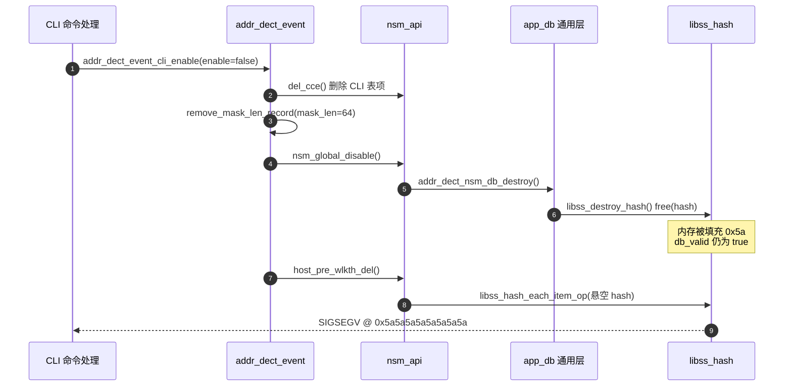

# addr_dect 进程 coredump 分析：哈希表销毁后仍被遍历（use-after-free）

## 一、结论

崩溃的直接现场是 `libss_hash_each_item_op()`（`addr_dect_db/spub_hash.c:182`），但**根因（root cause）不在该函数**，而在 `addr_dect_event_cli_enable()`（`addr_dect_event.c:347`）里两行调用的**顺序倒置**：

> 先执行「移除掩码记录」→ 该动作触发全局去使能 → **销毁并释放（free）整张 NSM 哈希表（hash table）**；
> 随后又执行「遍历 NSM 前缀表删除主机路由」→ 遍历的是一块**已被释放的内存**（悬空指针，dangling pointer）。

这是典型的释放后使用（use-after-free）缺陷。

叠加第二个缺陷：`addr_dect_nsm_api_destory()` 销毁时**没有把 `db_valid` 复位为 false**，导致 `host_pre_wlkth_del()` 入口唯一的保护判断失效，直接走进 `libss_hash_each_item_op()`。

| 项目 | 内容 |
|---|---|
| 崩溃类型 | 段错误（segmentation fault, SIGSEGV），访问地址 `0x5a5a5a5a5a5a5a5a` |
| 崩溃函数 | `libss_hash_each_item_op` @ `spub_hash.c:182` |
| 根因文件 | `addr_dect_event.c`（顺序）、`addr_dect_db_nsm_api.c`（状态标志） |
| 触发条件 | 仅存在**一条** IPv6 地址冲突检测配置时，下发对应的 `no` 命令 |
| 触发概率 | 单条配置 → 必现；多条不同掩码配置 → 不触发（掩码计数不归零） |
| 修复代价 | 调整两行调用顺序（必要）+ 补齐状态标志与空指针保护（加固） |

## 二、输入材料与现场概览

| 文件 | 作用 |
|---|---|
| `core.bin` | coredump 文件（约 46 MB） |
| `core-sw_app.addr_dct.gdb.txt` | gdb 的 `thread apply all bt full`、`info registers`、反汇编与符号打印结果 |
| `sw_app.addr_dct/` | 同一构建（build）的源码树 |

进程内共两个线程，`thread apply all bt` 的结果：

- **Thread 2（LWP 4280，LWP 即轻量级进程 lightweight process，Linux 线程号）**：阻塞在 `rg_syslog_send_msg_proc()` → `pthread_cond_timedwait()`（`sysloglib.c:4023`）。这是日志发送线程的**空闲等待**状态，正常，与本崩溃无关。
- **Thread 1（LWP 4245）**：崩溃线程，回溯见 [[#三、崩溃点：libss_hash_each_item_op 首轮取桶|三、崩溃点]]。

崩溃线程回溯（已剔除 `full` 输出的局部变量噪音）：

```
#0 libss_hash_each_item_op   spub_hash.c:182
#1 app_db_wkthrough          addr_dect_db_com.c:154
#2 addr_dect_db_nsm_api_host_pre_wlkth_del   addr_dect_db_nsm_api.c:527
#3 addr_dect_event_cli_enable                addr_dect_event.c（调用点 351 行）
#4 addr_dect_cli_set_ipv6_detect             addr_dect_cli.c:82
#5 _cli_check_cmd                            cli_kernel.c:2450
#6 0x0                                       （回溯链终止）
```

## 三、崩溃点：libss_hash_each_item_op 首轮取桶

`spub_hash.c` 中被执行的代码：

```c
/* spub_hash.c:176 */
int32_t libss_hash_each_item_op(libss_hash_t *hash, libss_hash_rv_op_t fun, void *para)
{
    int32_t             i;
    libss_hash_item_t   *hash_item, *hash_tmp;
    int32_t             rv;

    for (i = 0; i < hash->hash_table_size; i++) {           /* :182 */
        list_for_each_entry_safe(hash_item, hash_tmp, &hash->hash_table[i], list) {
            rv = (*fun)(hash_item->item, para);
            ...
```

`x/12i $pc-24` 的反汇编与寄存器可逐条对齐：

```
0x407fe0 <+16>:  ldr  w0, [x0]        ; hash->hash_table_size（偏移 0）
0x407fe4 <+20>:  cbz  w0, <+164>      ; 为 0 则直接退出循环
0x407fe8 <+24>:  ldr  x4, [x21, #24]  ; hash->hash_table（偏移 24）
0x407ff4 <+36>:  mov  x24, x2
0x407ff8 <+40>:  mov  w23, #0x0
0x407ffc <+44>:  stp  x19, x20, [sp, #16]
0x408000 <+48>:  mov  x20, #0x0
0x408004 <+52>:  add  x1, x4, x20
0x408008 <+56>:  ldr  x3, [x4, x20]   ; 读取链表首节点 → 触发异常
```

关键寄存器：

| 寄存器 | 值 | 含义 |
|---|---|---|
| x21 | `0xffff97590220` | 实参 `hash`，与 `p g_nsm_tbl` 打印的 `nsm_db_pre.hash` **完全一致**，说明入参传递正确 |
| x0 | `0x5a5a5a5a` | 从 `[hash+0]` 读出的 `hash_table_size`，已被填充为 `0x5a` |
| x4 | `0x5a5a5a5a5a5a5a5a` | 从 `[hash+24]` 读出的 `hash_table` 指针，非法 |
| x19 | `0x42b9f8` | `&g_nsm_tbl.nsm_tbl + 16`，即 `nsm_db_pre` 的地址，与 `#1` 帧的 `db=` 一致 |
| x22 | `0x4023d0` | `<db_wkthrough>`，回调函数地址正确 |
| sp | `0xffffc203f200` | 栈指针正常，排除栈溢出（stack overflow） |

> 说明：gdb 记录的程序计数器（pc）落在函数序言 `+40`（一条 `mov` 指令，本身不可能触发异常），属 `-O2` 优化后行表（line table）映射偏差；按反汇编推定真正触发异常的访问是紧随其后的 `ldr x3,[x4,x20]`。这不影响定位结论——`x0` 与 `x4` 两个取值已足以说明根源。

## 四、关键推断：hash 结构体已被释放

`libss_hash_t` 的定义（`spub_hash.h:18`）决定了偏移量：

| 偏移 | 字段 | 大小 |
|---|---|---|
| 0 | `hash_table_size` | 4 |
| 4 | `hash_item_num` | 4 |
| 8 | `hash_bucket_warn_size` | 4 |
| 16 | `hash_bucket_size` | 8（指针） |
| **24** | **`hash_table`** | 8（指针） |
| 32 / 40 | `hash_get_index` / `hash_cmp_key` | 8 / 8 |

三条证据共同证明**该结构体已被释放（free）**，而非从未初始化：

1. **`0x5a` 填充不是本模块产生的。** 对整棵源码树检索 `0x5a`、`5a5a`、`MALLOC_PERTURB` 均无命中。该填充值符合 glibc 的 `MALLOC_PERTURB_` 机制：当 `MALLOC_PERTURB_=90` 时，`free()` 会把被释放块整块填充为 `0x5a`（新分配块填充为 `0xa5`）。即**当前这块内存处于「已释放」状态**。
2. **不可能是「从未创建」。** `g_nsm_tbl` 位于 BSS 段（未初始化数据段，Block Started by Symbol），初值必然为 0。若哈希表从未创建，`hash_table_size` 应为 `0`，`cbz w0` 会直接跳出循环、不会崩溃。现值为 `0x5a5a5a5a`，说明「先分配过、后被释放」。
3. **销毁动作确实执行过。** `p g_nsm_tbl` 的打印结果中：

```
$2 = {tbl_valid = false,
      nsm_tbl = {db_id = 0,
                 db_valid = true,          ← 仍为 true（缺陷所在）
                 nsm_db_pre  = {..., size = 500000, current_num = 0, valid = false, ...},
                 nsm_db_nhid = {..., size = 500000, current_num = 0, valid = false, ...},
                 nsm_db_cli  = {..., size = 100,    current_num = 0, valid = false, ...}}}
```

三个子库的 `valid` **全部为 false**，而只有在 `addr_dect_nsm_db_destroy()`（`addr_dect_db_nsm.c:214`）中才会把这三个字段置 false；同时 `size` 字段仍是创建时的合法值（500000 / 500000 / 100），说明表**创建过**。另一条旁证：`p g_mask_rec` 显示 `mask_arr` 全 0、`mask_num = 0`、`glb_enable = false`，说明「掩码记录已移除、全局已去使能」这段逻辑已经跑完。

## 五、调用链还原

触发入口是 CLI 的删除配置命令。`addr_dect_cli_set_ipv6_detect()`（`addr_dect_cli.c:74`）根据 `pcdb->flag_nd_prefix` 决定 `enable` 取值：`NO_PREFIX` / `DEFAULT_PREFIX` 分支（`:108`）把 `cli_param.enable` 置为 `false`，即执行 `no address-detect ipv6-address conflict detect ...`。

事件层 `addr_dect_event_cli_enable()`（`addr_dect_event.c:284`）进入 no-enable 分支：

```c
/* addr_dect_event.c:347 */
} else {                                    /* no enable：只删表项 */
    if (get_result != NULL) {
        addr_dect_db_nsm_api_del_cce(&cli_entry);                 /* :349 删 CLI 表项 */
        addr_dect_event_remove_mask_len_record(cli_param->mask_len); /* :350 ← 埋雷 */
        addr_dect_db_nsm_api_host_pre_wlkth_del(&cli_entry);      /* :351 ← 踩雷 */
    }
    ret = SW_APP_NONE;
}
```

第 `:350` 行在「该掩码是最后一条配置」时引发的连锁：

```c
/* addr_dect_event.c:274 */
if ((g_mask_rec.mask_num == 0) && (get_conf() == true)) {
    addr_dect_event_set_target_ipv6_detect_en(false);   /* :276 */
}
        ↓
/* addr_dect_event.c:213 */
} else if ((enable == false) && g_mask_rec.glb_enable == true) {
    g_mask_rec.glb_enable = enable;                     /* 先置 false */
    addr_dect_nsm_global_disable();                     /* :215 */
}
        ↓
/* addr_dect_nsm_client.c:478 */
if (addr_dect_event_get_target_ipv6_detect_conf() == false) {
    service_sfib6_unwatch_bind_entry();
    addr_dect_nsm_api_destory();                        /* :486 */
}
        ↓
/* addr_dect_db_nsm_api.c:624 */
addr_dect_nsm_db_destroy(&(g_nsm_tbl.nsm_tbl));
        ↓  /* addr_dect_db_nsm.c:214，三张表逐个清空后销毁 */
app_db_destroy(&db->nsm_db_pre);      /* addr_dect_db_com.c:242 */
        ↓
libss_destroy_hash(db->hash);         /* spub_hash.c:81 → free(hash) */
```

此刻 `db->hash` 变成悬空指针，但 `db_valid` 仍为 `true`。

第 `:351` 行继续执行 `addr_dect_db_nsm_api_host_pre_wlkth_del()`（`addr_dect_db_nsm_api.c:511`），其入口保护形同虚设：

```c
NSM_DB_API_RET_VOID_IF_TRUE(entry == NULL);
NSM_DB_API_RET_VOID_IF_TRUE(g_nsm_tbl.nsm_tbl.db_valid == false);   /* :519 未能拦住 */
...
(void) addr_dect_nsm_db_all_wkthrough(&(g_nsm_tbl.nsm_tbl), S_NSM_DB_TYPE_PRE,
    addr_dect_host_addr_del, (void *)&param);                        /* :527 */
```

`app_db_wkthrough()`（`addr_dect_db_com.c:145`）→ `libss_hash_each_item_op(db->hash, ...)` → 访问已释放内存 → SIGSEGV。



## 六、根因：两处设计缺陷叠加

| 编号 | 缺陷 | 位置 | 性质 |
|---|---|---|---|
| 缺陷一 | 调用顺序倒置：先销毁数据库，后遍历同一数据库 | `addr_dect_event.c:350-351` | 逻辑顺序错误 |
| 缺陷二 | 销毁时不复位 `db_valid`，各 API 依赖该标志做有效性判断 | `addr_dect_nsm_api.c:620-629` | 状态标志漏清 |

两者缺一不可：**只有缺陷一**时，`:519` 的 `db_valid` 判断本可拦住这次崩溃（属"幸运地没崩"）；**只有缺陷二**时，顺序正确也不会走到已释放的表。二者同时存在，才形成这条稳定的崩溃路径。

补充说明：`addr_dect_nsm_api.c` 中另有 10 余处 API 都用 `g_nsm_tbl.nsm_tbl.db_valid == false` 做保护，因此在「销毁后、重新创建前」的窗口期，**所有** NSM 相关操作都存在同类风险，不止本路径。

## 七、修复方案

### 方案 A：调整调用顺序（必要，最小改动）

```c
/* addr_dect_event.c:347 起 */
} else {
    if (get_result != NULL) {
        addr_dect_db_nsm_api_del_cce(&cli_entry);
        /* 先遍历（此时数据库仍完整），再去使能（可能触发销毁） */
        addr_dect_db_nsm_api_host_pre_wlkth_del(&cli_entry);
        addr_dect_event_remove_mask_len_record(cli_param->mask_len);
    }
    ret = SW_APP_NONE;
}
```

顺序调整后语义不变：`del_cce()` 只删 CLI 表项，`host_pre_wlkth_del()` 依据 CLI 前缀去匹配并删除 PRE/NHID 表项，两者互不依赖，但**都必须在数据库销毁之前完成**。

### 方案 B：状态标志与空指针加固（必要，防复发）

1. `addr_dect_nsm_api_destory()` 内补齐状态复位：

```c
void addr_dect_nsm_api_destory(void)
{
    addr_dect_nsm_db_destroy(&(g_nsm_tbl.nsm_tbl));
    g_nsm_tbl.nsm_tbl.db_valid = false;      /* 新增 */
    g_nsm_tbl.tbl_valid = false;             /* 新增（该字段目前全流程从未置 true，属死字段，建议一并清理） */
}
```

2. `app_db_destroy()` 销毁后置空指针，通用层增加判空：

```c
int app_db_destroy(app_db_t *db)
{
    (void)pthread_mutex_destroy(&db->lock);
    libss_destroy_hash(db->hash);
    db->hash = NULL;                         /* 新增 */
    return 0;
}
```

3. `app_db_wkthrough()` / `app_db_add_entry()` / `app_db_del_entry()` / `app_db_get_entry()` 入口增加 `if (db->hash == NULL) return ...;`。

4. 各 API 的守护条件建议由「全局 `db_valid`」改为「该子库 `valid`」：`g_nsm_tbl.nsm_tbl.nsm_db_pre.valid == false` 等，语义更精确，也更难漏改。

### 方案 C：同源衍生缺陷（建议同批修复）

`addr_dect_nsm_tbl_create()`（`addr_dect_nsm_api.c:640`）用 `db_valid` 做幂等判断：

```c
if (g_nsm_tbl.nsm_tbl.db_valid) {
    ADDR_DECT_NOTICE("nsm table has create");
    return SW_APP_NONE;      /* 销毁后 db_valid 仍为 true → 直接返回，表根本没重建 */
}
```

后果：执行过一次 `no` 命令后重新使能，**哈希表不会被重建**，后续 `get` / `add` 继续操作已释放内存——表现为「删了再配必崩」，且崩溃点可能漂移到别处。修复方案 B 的第 1 条即可同时消除此隐患。

## 八、验证与复现方法

### 复现步骤（必现路径）

1. 设备上仅配置一条检测项，例如 `address-detect ipv6-address conflict detect fd00:1:4:72::/64 next-hop N`；
2. 确认 `g_mask_rec.mask_num == 1`、`glb_enable == true`；
3. 下发对应的 `no address-detect ipv6-address conflict detect fd00:1:4:72::/64`；
4. 进程在 `libss_hash_each_item_op` 处崩溃。

**为什么多条配置不崩**：`mask_num` 由 2 减到 1 时，`addr_dect_event.c:274` 的条件不成立，不会触发 `nsm_global_disable()`，数据库仍在，遍历安全。这也解释了现场为何是「偶发」。

### 修复后的验证要点

| 验证项 | 期望结果 |
|---|---|
| 单条配置 → `no` 命令 | 不崩溃，`addr_dect_nsm_db_destroy` 日志正常输出 |
| 两条不同掩码 → 删其中一条 | 不崩溃，剩余配置的路由仍可查 |
| `no` 后再 `配置` 同一掩码 | 日志出现 `nsm table create`（证明表被重建），功能恢复 |
| 内存工具复跑 | `MALLOC_PERTURB_=90` 或 ASAN（AddressSanitizer）下无 use-after-free 报告 |

### 现场取证速查命令

```
(gdb) thread apply all bt full
(gdb) info registers
(gdb) x/12i $pc-24
(gdb) p g_nsm_tbl
(gdb) p g_mask_rec
(gdb) p *((libss_hash_t *)0xffff97590220)     # 直接看被释放的 hash 结构体内容
(gdb) x/32x 0xffff97590220                    # 确认整块是否全为 0x5a
```

## 九、遗留隐患清单

按风险从高到低，建议纳入下一次代码评审：

1. **销毁—重建窗口期无保护**：`db_valid` 与各子库 `valid` 状态不一致（见 [[#四、关键推断：hash 结构体已被释放|四、关键推断]] 的 `p g_nsm_tbl` 输出），窗口期内所有 API 都可能踩空。
2. **`tbl_valid` 死字段**：全流程只在初始化时置 `false`，从未置 `true`，也无任何判断依赖它；建议删除或补齐语义。
3. **遍历中修改哈希表**：`host_pre_wlkth_del()` 的回调会删除表项，当前依赖 `list_for_each_entry_safe` 的"预取后继"机制才安全——它只能安全删除**当前节点**；若回调删除的是后继节点，`hash_tmp` 立即变成悬空指针。建议对该约束加注释固化，或将遍历改为「先收集、后批量删除」两阶段。
4. **`app_db_del_entry()` 中先 `free(item)` 后使用 `user_data`**：`addr_dect_db_com.c:94-96` 当前顺序正确（先取 `user_data` 再 `free`），但属易错写法，建议加注释。
5. **回溯链断裂**：`_cli_check_cmd` 帧参数为垃圾值（`cmd_str=0x1`）、`#6` 为 `0x0` 并提示 "corrupt stack"，系 CLI 调度层无帧指针（frame pointer）且经 `-O2` 优化所致，非栈溢出。若后续排障频繁受限，可考虑该模块单独用 `-fno-omit-frame-pointer` 编译。

## 附录：关键地址与变量对照

| 地址 / 变量 | 值 | 对应含义 |
|---|---|---|
| `g_nsm_tbl` | `0x42b9e8` | 全局表描述符（BSS 段） |
| `g_nsm_tbl + 16` | `0x42b9f8` | `nsm_db_pre` 起始地址，即 `#1` 帧的 `db` 参数 |
| `nsm_db_pre.hash` | `0xffff97590220` | 已释放的 `libss_hash_t` 块 |
| `nsm_db_nhid.hash` | `0xffff97590280` | 同批释放 |
| `nsm_db_cli.hash` | `0xffff97590a90` | 同批释放 |
| `hash->hash_table_size` | `0x5a5a5a5a` | 内存填充值，非真实表长 |
| `hash->hash_table` | `0x5a5a5a5a5a5a5a5a` | 内存填充值，崩溃时被解引用 |
| 崩溃前缀 | `fd00:1:4:72::/64`（`mask_len = 64`, `vrf_id = 0`） | 被删除的那条检测配置 |
| `g_mask_rec` | `mask_arr` 全 0 / `mask_num = 0` / `glb_enable = false` | 掩码记录已移除、全局已去使能 |

---

**一句话复盘**：数据库是「共享资源」，`no` 命令的处理路径把它当「局部资源」先用后弃——先销毁、后访问。修复只需承认「遍历也必须发生在销毁之前」，并把状态标志改成销毁即失效。
